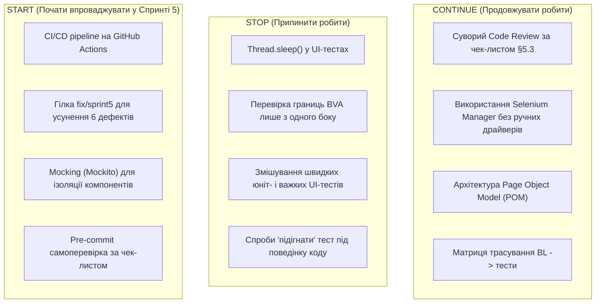

# Протокол командної ретроспективи Спринту 4 (Scrum Retrospective Protocol)

**Проєкт:** Автоматизована система дистанційного навчання «ЕдуПортал» (LMS)  
**Команда:** EduGuard (Команда F, 5 осіб, група ФБ-44)  
**Спринт 4:** «Автоматизація тестування: модульні тести JUnit 5 та інтерфейсні сценарії Selenium WebDriver»  
**Дата проведення:** 10 листопада 2026 року  
**Фасилітатор / Модератор:** Денис Бучинський (`Denchik`), Скрам-майстер  
**Учасники ретроспективи:**  
- Денис Бучинський (`Denchik`) — Скрам-майстер / Рецензент  
- Володимир Костенко (`vov4ik-qa`) — Керівник тестування (Test Lead)  
- Олександр Пархоменко (`parkhomenko-qa`) — Тест-аналітик (Test Analyst)  
- Олександр Кираківський (`Kyrakivskyi0`) — Інженер з тестування (SDET)  
- Олександр Панайотов (`5ani0chek`) — Аудитор якості / Опонент  

**Методологія:** Схема **Start / Stop / Continue** із формуванням таблиці дій (Action Items) на Спринт 5.

---

## 1. Загальний огляд спринту та досягнення команди

Спринт 4 був присвячений практичній автоматизації тестування на двох ключових рівнях піраміди тестування:
1. **Модульний рівень (Unit Testing):** розробка 24 автотестів на базі фреймворку JUnit 5 для перевірки складних правил бізнес-логіки BL-10..BL-80 модуля `ua.kpi.tzyapz.eduportal` (v1).
2. **Інтерфейсний рівень (UI Testing):** запис та експорт 2 сценаріїв у Selenium IDE, реалізація архітектури Page Object Model (POM) та 8 стабільних WebDriver-тестів для перевірки ключових сценаріїв Moodle.

Команда успішно виявила та локалізувала всі **6 закладених дефектів модуля v1** (100% результат), жоден тест не підганявся під некоректну реалізацію, а всі Pull Requests пройшли формальне рецензування за чек-листом §5.3.

---

## 2. Аналіз процесів за моделлю Start / Stop / Continue

### 2.1. CONTINUE (Що спрацювало відмінно та закріплюється як командний стандарт)
1. **Формальне Code Review за 8-пунктовим чек-листом §5.3:**  
   Практика обов'язкового рецензування Скрам-майстром кожного PR дозволила вчасно відхилити застарілі конструкції (`Thread.sleep`, послідовні асерти замість `assertAll`) та забезпечити бездоганну якість кодової бази.
2. **Автоматичне керування драйверами через Selenium Manager:**  
   Selenium 4.21.0 повністю зняв проблему сумісності локальних версій Google Chrome та `chromedriver.exe` на машинах членів команди.
3. **Патерн Page Object Model (POM):**  
   Чітке відокремлення локаторів і методів сторінок (`LoginPage`, `DashboardPage` тощо) від тіла тестових сценаріїв забезпечило високу читабельність та простоту модифікації UI-тестів.
4. **Рання декомпозиція вимог та матриця BVA:**  
   Попередній ручний розрахунок очікуваних результатів на калькуляторі дозволив миттєво відрізнити помилку коду модуля від помилки тесту.

### 2.2. STOP (Що створювало проблеми або знижувало ефективність)
1. **Використання `Thread.sleep()`:**  
   У перших чернетках UI-тестів зустрічалися жорсткі паузи на 2–3 секунди. Це призводило до штучного уповільнення тестів і не рятувало від падінь при повільній мережі. *Рішення: повністю заборонити `Thread.sleep` на рівні Code Review; використовувати виключно `WebDriverWait` із явними умовами.*
2. **Односторонній аналіз меж (BVA):**  
   Спроби перевірити діапазон лише однією точкою (наприклад, 95.0 без перевірки 94.99 та 95.01) ледь не призвели до пропуску дефекту в ECTS-шкалі. *Рішення: суворо дотримуватися правила перевірки трьох точок ($N-\Delta, N, N+\Delta$).*
3. **Запуск UI-тестів без прапорця сепарації:**  
   Випадковий запуск UI-тестів у повсякденному `mvn test` гальмував розробку. *Рішення: обов'язкове маркування `@Tag("ui")` та конфігурація Surefire `<excludedGroups>ui</excludedGroups>`.*
4. **Спроби підганяння (Fitting):**  
   Первинне бажання автора зробити "зелений" білд шляхом зміни очікуваного значення під помилковий вивід коду. *Рішення: суворе правило — якщо вимога каже інше, тест має падати, а дефект іде в трекер.*

### 2.3. START (Що нового команда починає робити у Спринті 5)
1. **Автоматизація CI через GitHub Actions:**  
   Налаштувати автоматичну компіляцію та запуск юніт-тестів на GitHub при кожному Pull Request до гілки `main`.
2. **Розробка гілки багфіксів `fix/sprint5-module-defects`:**  
   Використовуючи створений у Спринті 4 набір автотестів як регресійний бар'єр, виправити всі 6 закладених дефектів модуля `ua.kpi.tzyapz.eduportal`.
3. **Впровадження Mockito:**  
   Розширити тестування інтеграційних сценаріїв із використанням mock-об'єктів для симуляції зовнішніх сервісів бази даних та розсилки сповіщень.
4. **Самоконтроль за чек-листом перед PR:**  
   Кожен автор перед створенням PR зобов'язаний сам перевірити свій код за 8 пунктами §5.3, щоб зменшити час на рецензування.

---

## 3. Таблиця рішень та дій на Спринт 5 (Action Items)

| № | Конкретна дія (Action Item) | Відповідальний | Термін (Deadline) | Критерій успіху (DoD) |
|:---:|:---|:---:|:---:|:---|
| **ACT-01** | Створити гілку `fix/sprint5-module-defects` та внести виправлення у 3 класи модуля (`GradeCalculator`, `QuizScorer`, `EnrollmentValidator`). | О. Кираківський (SDET) | Спринт 5, День 2 | Усі 6 виправлень відповідають специфікації SRS |
| **ACT-02** | Прогнати повний регресійний набір із 24 юніт-тестів та підтвердити проходження 100% тестів (`Build Success`, 0 failed). | В. Костенко (Test Lead) | Спринт 5, День 3 | Усі тести зелені без зміни їхнього тіла |
| **ACT-03** | Скласти звіт верифікації виправлених дефектів із закриттям Issues у GitHub Tracker. | **Д. Бучинський (SM)** | Спринт 5, День 4 | Статуси дефектів змінено на Closed/Fixed |
| **ACT-04** | Налаштувати GitHub Actions CI workflow для автоматичного прогону тестів. | О. Кираківський (SDET) | Спринт 5, День 4 | Зелений бейдж CI у репозиторії проєкту |
| **ACT-05** | Провести перехресний аудит оновленого інкременту v2 та підготувати підсумковий звіт. | О. Панайотов (Auditor) | Спринт 5, День 5 | Підписаний звіт аудиту інкременту v2 |

---

## 4. Оцінка командного клімату та взаємодії

- **Team Happiness Index:** **9.6 / 10** (відмінна взаємодопомога, чіткий розподіл ролей, відсутність конфліктів під час рецензування коду).
- **Дотримання Scrum-процедур:** 100% (щоденні стендапи проведено вчасно, дошка задач підтримувалася в актуальному стані).
- **Готовність до публічного захисту (Demo):** **100%**.

*Протокол оформив та затвердив Скрам-майстер команди EduGuard: Денис Бучинський (`Denchik`)*
