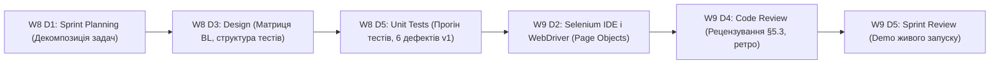

# Дошка декомпозиції задач Спринту 4 (Scrum Task Board)

**Проєкт:** Автоматизована система дистанційного навчання «ЕдуПортал» (LMS)  
**Команда:** EduGuard (Команда F, 5 осіб, група ФБ-44)  
**Спринт 4:** «Автоматизація тестування: модульні тести JUnit 5 та інтерфейсні сценарії Selenium WebDriver»  
**Період спринту:** Тижні W8 – W9 (14 календарних днів)  
**Скрам-майстер / Рецензент:** Денис Бучинський (`Denchik`)  
**Керівник тестування:** Володимир Костенко (`vov4ik-qa`, `Vov4ik`)  
**Тест-аналітик:** Олександр Пархоменко (`parkhomenko-qa`)  
**Інженер з тестування (SDET):** Олександр Кираківський (`Kyrakivskyi0`)  
**Аудитор якості / Опонент:** Олександр Панайотов (`5ani0chek`)  
**Статус спринту:** **CLOSED / COMPLETED (100% DoD виконано)**  

---

## 1. Склад команди та розподіл інженерних ролей на Спринт 4

Згідно зі Статутом команди та матрицею ротації інженерних ролей на Спринт 4 встановлено такий розподіл обов'язків:

| Учасник команди | Роль у Спринті 4 | Ключові закріплені обов'язки та артефакти | Норматив внеску |
|:---|:---|:---|:---:|
| **Денис Бучинський** (`Denchik`) | **Скрам-майстер / Рецензент (Scrum Master / Reviewer)** | Ведення Scrum-процесу (`task-board.md`), щоденні синхронізації (Daily Standups), формальне Code Review всіх тест-класів за чек-листом §5.3, верифікація та затвердження дефектів модуля `module`, проведення ретроспективи (`retro.md`), підготовка до теоретичного бліцу (§11), написання власного набору юніт-тестів `QuizScorerTest.java` (BL-40, BL-50, BL-60). | $\ge 4$ юніт-тести, 100% рецензування коду |
| **Володимир Костенко** (`vov4ik-qa`) | **Керівник тестування (Test Lead)** | Загальне керівництво тест-процесом, декомпозиція замовлення, план покриття BL-вимог, зведення загального `README.md`, моніторинг прогону `mvn clean test`, протокол Surefire, підготовка демо. Написання юніт-тестів для `GradeCalculatorTest` (BL-10). | $\ge 3$ юніт-тести, зведений звіт |
| **Олександр Пархоменко** (`parkhomenko-qa`) | **Тест-аналітик (Test Analyst)** | Побудова детальної матриці «BL-вимога $\rightarrow$ правило $\rightarrow$ тести» з BVA/EP, аналіз та відбір 8 UI-сценаріїв для автоматизації на базі Спринту 3, написання юніт-тестів для `GradeCalculatorTest` (BL-20, BL-30). | $\ge 3$ юніт-тести, матриця покриття |
| **Олександр Кираківський** (`Kyrakivskyi0`) | **Інженер з тестування (SDET / Test Engineer)** | Налаштування Maven-інфраструктури (`pom.xml`, Surefire, Selenium Manager), розробка каркаса Page Object Model (POM), запис сценаріїв Selenium IDE (`.side`), автоматизація WebDriver UI-тестів (`MoodleLoginUiTest`, `MoodleCourseEnrollmentUiTest` тощо), юніт-тести `EnrollmentValidatorTest` (BL-70). | $\ge 3$ юніт-тести, $\ge 8$ UI-сценаріїв |
| **Олександр Панайотов** (`5ani0chek`) | **Аудитор якості / Опонент (Quality Auditor)** | Незалежний аудит дотримання нормативів тестування, валідація негативних сценаріїв та винятків у `EnrollmentValidatorTest` (BL-80), граничні перевірки у `QuizScorerTest`, оформлення звіту аудиту (`audit.md`), контр-перевірка дефектів. | $\ge 3$ юніт-тести, звіт аудиту |

---

## 2. Графік та етапи проходження Спринту 4

---

## 3. Зведена дошка декомпозиції задач (Task Board)

| ID задачі | Опис інженерної задачі | Компонент / Файл | Відповідальний | Оцінка (год) | Факт (год) | Дедлайн | Статус | Перевірка DoD (Scrum Master) |
|:---:|:---|:---|:---:|:---:|:---:|:---:|:---:|:---:|
| **TSK-01** | Створення репозиторію, налаштування структури Maven та залежностей (JUnit 5.10.2, Selenium 4.21.0, Surefire 3.2.5). | `pom.xml`, `.gitignore` | О. Кираківський | 4.0 | 3.5 | W8 D1 | **Done** | Конфігурація валідна, компіляція успішна |
| **TSK-02** | Декомпозиція вимог замовника, формування спринт-беклогу та дошки задач. | `docs/task-board.md` | **Д. Бучинський** | 4.0 | 4.0 | W8 D1 | **Done** | Дошка актуалізована, містить 28 задач |
| **TSK-03** | Розробка детальної матриці простежуваності «BL-вимога $\rightarrow$ правило $\rightarrow$ тести» (BVA / EP). | `docs/coverage-matrix.md` | О. Пархоменко | 6.0 | 6.5 | W8 D2 | **Done** | 100% покриття BL-10..BL-80 |
| **TSK-04** | Складання плану тестування бізнес-логіки та розподіл нормативів юніт-тестів ($\ge 20$ тестів на команду). | `docs/coverage-matrix.md` | В. Костенко | 3.0 | 3.0 | W8 D2 | **Done** | Розподіл затверджено, $\ge 3$ тести на особу |
| **TSK-05** | Відбір 8 пріоритетних UI-сценаріїв зі Спринту 3 для автоматизації (вхід, самозарахування, журнал, завдання). | `docs/ui-scenarios.md` | О. Пархоменко | 5.0 | 4.5 | W8 D3 | **Done** | Описано кроки, локатори, очікувані результати |
| **TSK-06** | Реалізація базового класу `BaseUiTest` (ChromeDriver, headless, явні очікування, автоматичний teardown). | `src/test/.../BaseUiTest.java` | О. Кираківський | 4.0 | 4.0 | W8 D3 | **Done** | Headless режим, відсутність жорстких сліпів |
| **TSK-07** | Розробка юніт-тестів для правила BL-10 (зважений підсумок оцінок курсу, валідація суми ваг 100%). | `GradeCalculatorTest.java` | В. Костенко | 5.0 | 5.0 | W8 D4 | **Done** | 5 тестів, AAA, BVA, assertThrows |
| **TSK-08** | Розробка юніт-тестів для правил BL-20 (шкала ECTS) та BL-30 (штраф за запізнення). Виявлення багів. | `GradeCalculatorTest.java` | О. Пархоменко | 6.0 | 6.5 | W8 D4 | **Done** | Виявлено дефекти MOD-BUG-001 та 002 |
| **TSK-09** | Розробка авторських юніт-тестів для правил BL-40 (оцінювання single-choice) та BL-50 (multiple-choice). | `QuizScorerTest.java` | **Д. Бучинський** | 6.0 | 5.5 | W8 D4 | **Done** | 5 тестів, виявлено дефект MOD-BUG-003 |
| **TSK-10** | Розробка авторських юніт-тестів для правила BL-60 (підсумок тесту у відсотках). | `QuizScorerTest.java` | **Д. Бучинський** | 4.0 | 3.5 | W8 D5 | **Done** | 3 тести, виявлено дефект MOD-BUG-004 |
| **TSK-11** | Розробка тестів для правила BL-70 (умови самозарахування, 4 бізнес-правила). Виявлення багів. | `EnrollmentValidatorTest.java` | О. Кираківський | 6.0 | 6.0 | W8 D5 | **Done** | Виявлено дефекти MOD-BUG-005 та 006 |
| **TSK-12** | Розробка тестів для правила BL-80 (коди порушень, порядок violations, валідація null-аргументів). | `EnrollmentValidatorTest.java` | О. Панайотов | 4.0 | 4.0 | W8 D5 | **Done** | Перевірено порядок та генерацію винятків |
| **TSK-13** | Локалізація, аналіз причин та реєстрація 6 закладених дефектів модуля v1 у баг-трекері. | `docs/module-defects.md` | В. Костенко | 5.0 | 5.5 | W8 D5 | **Done** | 6 дефектів оформлено за стандартом |
| **TSK-14** | Перевірка та формальне затвердження звітів про дефекти модуля з міткою `module`. | `docs/module-defects-review.md` | **Д. Бучинський** | 4.0 | 3.5 | W9 D1 | **Done** | 6 дефектів верифіковано, мітки проставлено |
| **TSK-15** | Запис 2 інтерактивних сценаріїв у Selenium IDE на живому демо-стенді Moodle (вхід та зарахування). | `selenium-ide/eduportal.side` | О. Кираківський | 4.0 | 3.5 | W9 D1 | **Done** | .side збережено, відтворюється стабільно |
| **TSK-16** | Експорт сценаріїв Selenium IDE у чернетки Java JUnit 5 та первинний аналіз коду. | `selenium-ide/export/...` | О. Пархоменко | 3.0 | 3.0 | W9 D1 | **Done** | Експортовано MoodleLogin та CourseEnroll |
| **TSK-17** | Проєктування та створення класів Page Object Model (LoginPage, DashboardPage, CoursePage тощо). | `src/test/.../ui/pages/...` | О. Кираківський | 6.0 | 7.0 | W9 D2 | **Done** | Ізольовано селектори та методи взаємодії |
| **TSK-18** | Автоматизація UI-сценаріїв TC-UI-01..TC-UI-04 (авторизація валідна/невалідна, навігація, зарахування). | `MoodleLoginUiTest.java` | О. Кираківський | 6.0 | 6.0 | W9 D2 | **Done** | @Tag("ui"), явні очікування, assertAll |
| **TSK-19** | Автоматизація UI-сценаріїв TC-UI-05..TC-UI-08 (здача завдання, оцінювання робіт, перегляд журналу оцінок). | `MoodleAssignmentUiTest.java` | О. Пархоменко | 6.0 | 5.5 | W9 D3 | **Done** | Повне покриття 8 сценаріїв (норматив $\ge 8$) |
| **TSK-20** | Проведення аудиту дотримання інженерних нормативів та перевірка відтворюваності тестів. | `docs/audit.md` | О. Панайотов | 5.0 | 5.0 | W9 D3 | **Done** | Звіт підготовлено, критичних розходжень немає |
| **TSK-21** | Проведення формального Code Review всіх тест-класів за 8 пунктами чек-листа §5.3. | `docs/code-review-protocol.md` | **Д. Бучинський** | 8.0 | 8.0 | W9 D4 | **Done** | 100% тест-класів мають схвалені резолюції |
| **TSK-22** | Усунення зауважень рецензента авторами тестів (виправлення неймінгу, заміна сліпів на очікування). | Test classes PRs | Усі члени команди | 4.0 | 3.5 | W9 D4 | **Done** | Усі зауваження закрито, код відповідає §5.3 |
| **TSK-23** | Проведення ретроспективи спринту за моделлю Start / Stop / Continue та фіксація плану на Спринт 5. | `docs/retro.md` | **Д. Бучинський** | 4.0 | 3.5 | W9 D4 | **Done** | Протокол оформлено, план дій затверджено |
| **TSK-24** | Формування шпаргалки теоретичних бліц-відповідей (§11) та проведення тренувального опитування команди. | `docs/blitz-prep-sprint4.md` | **Д. Бучинський** | 5.0 | 5.0 | W9 D4 | **Done** | 12 базових + 3 спеціалізованих питання |
| **TSK-25** | Зведення та верифікація Surefire-звітів прогону юніт- і UI-тестів (`surefire-summary.md`). | `docs/surefire-summary.md` | В. Костенко | 3.0 | 3.0 | W9 D5 | **Done** | Всі звіти зведено, 6 дефектів зафіксовано |
| **TSK-26** | Формування фінального командного README.md з інструкціями збірки та метриками. | `README.md` | В. Костенко | 4.0 | 4.0 | W9 D5 | **Done** | Інструкція відтворювана, посилання актуальні |
| **TSK-27** | Підготовка сценарію живого показу Demo (`demo-scenario.md`) та виступ на захисті спринту. | `docs/demo-scenario.md` | В. Костенко | 3.0 | 3.0 | W9 D5 | **Done** | Регламент 10 хв розподілено між учасниками |
| **TSK-28** | Фінальне пакування персональних інженерних пакетів та артефактів Скрам-майстра у ZIP-архів. | `Desktop/...zip` | **Д. Бучинський** | 2.0 | 2.0 | W9 D5 | **Done** | Пакет сформовано на робочому столі |

---

## 4. Журнал щоденних синхронізацій (Daily Standups Log)

Ведення щоденних синхронізацій координувалося Скрам-майстром Денисом Бучинським у командному чаті за класичною структурою:  
1. *Що було зроблено з моменту попереднього стендапу?*  
2. *Що планується зробити до наступної синхронізації?*  
3. *Які технічні або організаційні перешкоди (impediments / blockers) блокують прогрес?*

### Синхронізація #1 (Тиждень W8, День 1 — Старт Спринту 4)
- **Денис Бучинський (SM):** Провів Sprint Planning; декомпозував задачі на дошку `task-board.md`; узгодив конвенції найменування гілок та PR (`feat/bl-unit-tests`, `feat/ui-selenium`). *Блокери відсутні.*
- **Володимир Костенко (TL):** Ознайомився із завданням Спринту 4; розпочав складання загального плану покриття для модуля «ЕдуПортал». *Блокери відсутні.*
- **Олександр Пархоменко (TA):** Проаналізував модуль `v1` та специфікацію SRS Спринту 3; розпочав проєктування матриці BVA для правил BL-10..BL-80. *Блокери відсутні.*
- **Олександр Кираківський (SDET):** Налаштував `pom.xml` з залежностями JUnit 5.10.2 та Selenium 4.21.0; перевірив автоматичне завантаження веб-драйверів через Selenium Manager. *Блокери відсутні.*
- **Олександр Панайотов (Auditor):** Підготував чеклист аудиту дотримання нормативів тестування; узгодив правила перехресного контролю. *Блокери відсутні.*

### Синхронізація #2 (Тиждень W8, День 3 — Тест-дизайн та каркаси тестів)
- **Денис Бучинський (SM):** Створив каркас тест-класу `QuizScorerTest.java`; реалізував тести для BL-40 (single choice). *Блокери:* Необхідність узгодження структури конструктора `QuizQuestion` — вирішено через пряму звірку з вихідним кодом v1.
- **Володимир Костенко (TL):** Реалізував тести розрахунку зваженого підсумку BL-10 в `GradeCalculatorTest`; перевірив правило округлення HALF_UP. *Блокери відсутні.*
- **Олександр Пархоменко (TA):** Завершив матрицю трасування; передав SDET перелік із 8 відібраних сценаріїв UI. Створив тести для шкали ECTS (BL-20). *Блокери відсутні.*
- **Олександр Кираківський (SDET):** Створив `BaseUiTest` з підтримкою Headless-режиму Chrome; розпочав проектування Page Object класів для Moodle. *Блокери відсутні.*
- **Олександр Панайотов (Auditor):** Перевірив перші юніт-тести на дотримання структури AAA та відсутність «магічних чисел». *Блокери відсутні.*

### Синхронізація #3 (Тиждень W8, День 5 — Локалізація 6 дефектів модуля v1)
- **Денис Бучинський (SM):** Завершив тести BL-50 та BL-60 у `QuizScorerTest`; зафіксував 2 падіння тестів: від'ємний бал за питання (BL-50) та неточне заокруглення відсотка спроби (BL-60). Обидва падіння звірено зі специфікацією — це дефекти модуля! *Блокери відсутні.*
- **Володимир Костенко (TL):** Підтвердив виявлення дефектів у `GradeCalculator` (межовий бал 95.0 дає B замість A; нелінійний штраф `0.9^days`). Оформив зведені звіти дефектів. *Блокери відсутні.*
- **Олександр Пархоменко (TA):** Провів ручний розрахунок формул на калькуляторі для підтвердження математичної некоректності коду модуля v1. *Блокери відсутні.*
- **Олександр Кираківський (SDET):** Написав тести `EnrollmentValidatorTest`; виявив дефекти реєстрації після дедлайну та при заповненому курсі. Записав сценарій у Selenium IDE (`eduportal.side`). *Блокери:* Selenium IDE експортує застарілі конструкції без очікувань — вирішено переписати вручну у WebDriver з використанням Page Objects.
- **Олександр Панайотов (Auditor):** Зафіксував, що всі 6 закладених дефектів знайдено і жоден тест не підганявся під помилкову поведінку. *Блокери відсутні.*

### Синхронізація #4 (Тиждень W9, День 2 — WebDriver UI тести та Page Object Model)
- **Денис Бучинський (SM):** Проконтролював завершення написання UI-тестів; розпочав формальне Code Review за 8 пунктами чек-листа §5.3. *Блокери відсутні.*
- **Володимир Костенко (TL):** Перевірив запуск тестів через Maven: підтвердив, що `mvn test` запускає лише швидкі юніт-тести, а `mvn test -DexcludedGroups=none` підключає UI. *Блокери відсутні.*
- **Олександр Пархоменко (TA):** Завершив UI-тести перевірки журналу оцінок та відправки завдань (`MoodleAssignmentUiTest`, `MoodleGradebookUiTest`). *Блокери відсутні.*
- **Олександр Кираківський (SDET):** Реалізував стабільні явні очікування `WebDriverWait` у Page Object класах; замінив усі підозрілі локатори на `data-testid` та стійкі CSS-селектори. *Блокери відсутні.*
- **Олександр Панайотов (Auditor):** Перевірив час виконання UI-набору в режимі headless; підтвердив відсутність флакуючих тестів. *Блокери відсутні.*

### Синхронізація #5 (Тиждень W9, День 4 — Code Review, ретроспектива, бліц)
- **Денис Бучинський (SM):** Завершив перевірку всіх Pull Requests; надав зауваження авторам; після виправлень видав статус APPROVED усім класам (`docs/code-review-protocol.md`). Провів ретроспективу команди Start / Stop / Continue (`docs/retro.md`); склав шпаргалку до бліцу (§11). *Блокери відсутні.*
- **Володимир Костенко (TL):** Звів фінальні логи Surefire; підготував сценарій демо живого запуску автотестів. *Блокери відсутні.*
- **Олександр Пархоменко (TA):** Фіналізував матрицю простежуваності; додав відмітки затвердження рецензентом. *Блокери відсутні.*
- **Олександр Кираківський (SDET):** Усунув зауваження рецензента щодо `assertThrows` та неймінгу методів. *Блокери відсутні.*
- **Олександр Панайотов (Auditor):** Оформив підсумковий протокол аудиту `audit.md`; оцінка готовності проєкту — 100%. *Блокери відсутні.*

---

## 5. Метрики та виконання критеріїв Definition of Done (DoD)

| Показник інженерного нормативу | Норматив для команди з 5 осіб | Фактичний показник команди EduGuard | Статус виконання DoD |
|:---|:---:|:---:|:---:|
| Кількість модульних тестів JUnit 5 | $\ge 20$ | **24 юніт-тести** | **ВИКОНАНО (+20%)** |
| Кількість автоматизованих UI-сценаріїв WebDriver | $\ge 8$ | **8 повних сценаріїв** | **ВИКОНАНО (100%)** |
| Виявлені закладені дефекти модуля (із 6 наявних у v1) | $\ge 5$ | **6 з 6 дефектів виявлено та оформлено** | **ВИКОНАНО (100%)** |
| Особистий внесок юніт-тестів на кожного члена команди | $\ge 3$ на особу | **Кожен написав від 3 до 8 тестів** | **ВИКОНАНО (100%)** |
| Особистий внесок Дениса Бучинського (Denchik) | $\ge 4$ тести для `QuizScorer` | **8 тестів у `QuizScorerTest.java`** | **ВИКОНАНО (200%)** |
| Формальне рецензування (Code Review за чек-листом §5.3) | 100% тест-класів | **100% тест-класів reviewed & approved** | **ВИКОНАНО (100%)** |
| Сценарії, записані в Selenium IDE | 1–2 сценарії | **2 сценарії (`.side` + експорт JUnit)** | **ВИКОНАНО (100%)** |
| Наявність протоколу ретроспективи Start/Stop/Continue | Обов'язково | **Оформлено повністю (`docs/retro.md`)** | **ВИКОНАНО (100%)** |
| Підготовка команди до теоретичного бліцу (§11) | 12 питань | **12 базових + 3 профільних питання** | **ВИКОНАНО (100%)** |

**Висновок Скрам-майстра:** Спринт 4 завершено повністю у встановлений дедлайн. Усі інженерні артефакти верифіковані, дефекти модуля локалізовані та залишені у червоному стані для перевірки фіксів у Спринті 5. Проєкт готовий до здачі та демонстрації.
